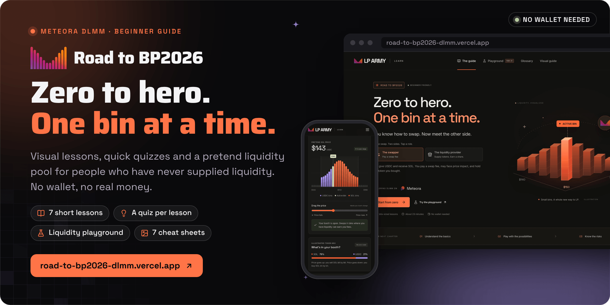
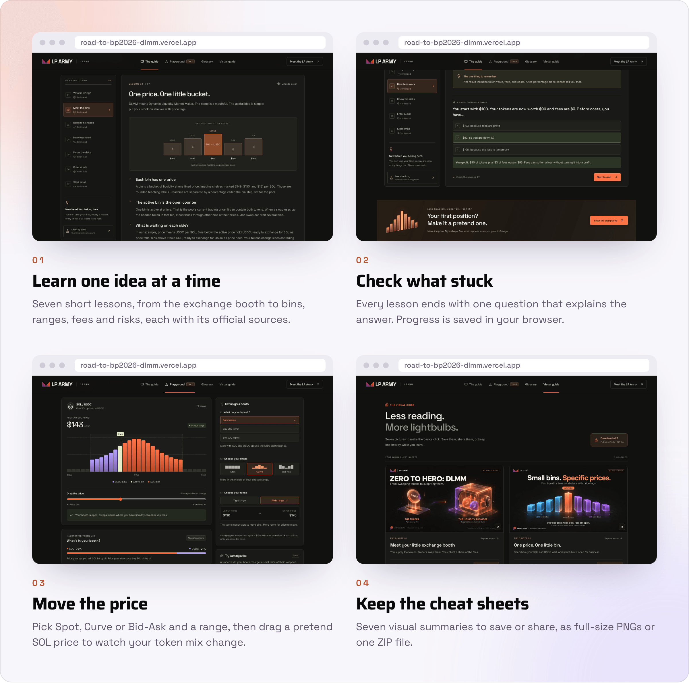

<div align="center">



<br><br>

<a href="https://road-to-bp2026-dlmm.vercel.app"></a>&nbsp;&nbsp;
<a href="https://road-to-bp2026-dlmm.vercel.app/#playground"></a>&nbsp;&nbsp;
<a href="https://road-to-bp2026-dlmm.vercel.app/#graphics"></a>

<br><br>

<a href="https://road-to-bp2026-dlmm.vercel.app"></a>


<h3>You know how to swap. Now meet the other side.</h3>

<b>Read</b> &nbsp;→&nbsp; <b>Check</b> &nbsp;→&nbsp; <b>Practice</b> &nbsp;→&nbsp; <b>Plan</b>

<br>

<a href="#how-it-works">How it works</a> &nbsp;·&nbsp;
<a href="#status">Status</a> &nbsp;·&nbsp;
<a href="#run-it-locally">Run it locally</a> &nbsp;·&nbsp;
<a href="#content-sources-and-branding">Content and branding</a> &nbsp;·&nbsp;
<a href="#documentation">Docs</a>

</div>

<br>

<picture>
  <source media="(prefers-color-scheme: dark)" srcset="docs/readme/screens-dark.png">
  
</picture>

<p align="center"><sub>Captured from a local production build on 30 October 2026. Every number in the playground is illustrative.</sub></p>

**Road to BP2026 is a free, beginner-friendly guide to liquidity providing on Meteora DLMM, written for people who have never supplied liquidity, including people new to crypto.** Seven short lessons explain pools, bins, ranges, fees, risks, entry and exit with everyday analogies, each one ends with a one-question check, and a playground lets you drag a pretend SOL price through your own bins. Nothing touches a wallet or real money: the playground is an educational allocation model, not a profit calculator or a trading tool.

Built by Matt ([RVAClassic](https://x.com/rvaclassic), [Operator Uplift](https://operatoruplift.com)) in October 2026 for the [LP Army bounty](https://www.lparmy.com/bounties/ca13defa-7639-41d2-b26f-50c4010cf95b) that asks for a beginner guide to bins, ranges, fees, entry, exit and sizing.

<br>

## How it works

<picture>
  <source media="(prefers-color-scheme: dark)" srcset="docs/readme/flow-dark.png">
  
</picture>

<table>
  <tr valign="top">
    <td width="33%"><b>Nothing real at stake</b><br><sub>No wallet connection, transactions, live market data or personal information, and no visitor tracking. The playground uses fixed $2 price steps and allocation weights to show the idea; it does not forecast returns.</sub></td>
    <td width="33%"><b>Checked against the docs</b><br><sub>Each lesson links the primary Meteora pages it relies on. <a href="CONTENT_NOTES.md">Content notes</a> record what was verified on 16 October 2026 and which popular claims were corrected, such as a fixed 69-bin limit or a fixed rent refund.</sub></td>
    <td width="33%"><b>Made for beginners</b><br><sub>Plain-English explanations, a searchable glossary of 22 terms, optional read-aloud, keyboard controls, reduced-motion support and self-hosted fonts. Layouts were checked down to 320 pixels wide.</sub></td>
  </tr>
</table>

Each interactive tool sits next to the lesson it explains. Most of them were added in the [eight-point audit](AUDIT.md):

<table>
  <tr>
    <th width="22%" align="left">Tool</th>
    <th width="52%" align="left">What it shows</th>
    <th width="26%" align="left">Where to find it</th>
  </tr>
  <tr valign="top">
    <td><b>Swapper or LP</b></td>
    <td>Two role buttons contrast paying a swap fee with supplying tokens and receiving a share.</td>
    <td>Home</td>
  </tr>
  <tr valign="top">
    <td><b>Bin step lab</b></td>
    <td>How the percentage gap between prices changes the reach of the same 69 example bins.</td>
    <td>Meet the bins lesson</td>
  </tr>
  <tr valign="top">
    <td><b>Playground</b></td>
    <td>Spot, Curve and Bid-Ask over a tight or wide range, with both tokens, USDC to buy SOL lower, or SOL to sell higher. Move the price to see the token mix change and what going out of range means.</td>
    <td>Playground</td>
  </tr>
  <tr valign="top">
    <td><b>Fee demo</b></td>
    <td>A base fee plus an illustrative volatility fee, capped at a 10% total swap fee. The volatility mapping is a teaching device, not Meteora's real formula.</td>
    <td>Playground fee panel</td>
  </tr>
  <tr valign="top">
    <td><b>Net PnL example</b></td>
    <td>Fees set against a fall in token value, with optional costs and a comparison with simply holding the same tokens.</td>
    <td>Know the risks lesson</td>
  </tr>
  <tr valign="top">
    <td><b>Entry checklist</b></td>
    <td>Four planning statements to tick before entering. A complete checklist means a plan exists, not that a pool is safe.</td>
    <td>Enter and exit lesson</td>
  </tr>
  <tr valign="top">
    <td><b>Where to go next</b></td>
    <td>Direct links to the LP Army Academy, Playground, Strategy Library and Community Tools.</td>
    <td>Start small lesson</td>
  </tr>
</table>

<p align="center"><sub>React 19 · TypeScript 5.9 (strict) · Vite 7 · lucide-react · Fontsource Inter and Space Grotesk · node:test through tsx · Vercel static hosting</sub></p>

<br>

## Status

<table>
  <tr valign="top">
    <td width="16%" align="center"></td>
    <td>The guide at <a href="https://road-to-bp2026-dlmm.vercel.app">road-to-bp2026-dlmm.vercel.app</a>: seven lessons with knowledge checks, the playground, the glossary and the visual guide. A static site with no backend and no environment variables.</td>
    <td width="22%"><a href="vercel.json">Vercel config</a></td>
  </tr>
  <tr valign="top">
    <td align="center"></td>
    <td>Written for the LP Army bounty for a beginner DLMM guide. The audit of 16 October 2026 maps each requested feature to where it lives, and a community report on 18 October led to the single-sided shape fix.</td>
    <td><a href="AUDIT.md">Feature audit</a></td>
  </tr>
  <tr valign="top">
    <td align="center"></td>
    <td>A community learning guide, not an official Meteora or LP Army product, and not financial advice. Practice values are illustrative: no wallet, transactions, live market data or backtesting.</td>
    <td><a href="#content-sources-and-branding">Content and branding</a></td>
  </tr>
</table>

<br>

## Run it locally

<table>
  <tr valign="top">
    <td width="33%"><b>Prerequisites</b><br><sub>Node.js 22.12 or newer, or Node 24, and npm. No keys, database or wallet.</sub></td>
    <td width="33%"><b>Read first</b><br><sub><a href="CONTENT_NOTES.md">Content notes</a> before changing lesson copy, and the <a href="AUDIT.md">audit</a> for what each tool may and may not claim.</sub></td>
    <td width="33%"><b>What the checks prove</b><br><sub><code>npm test</code> runs 13 tests of the playground model and the PnL arithmetic. <code>npm run build</code> typechecks with <code>tsc -b</code>, then builds.</sub></td>
  </tr>
</table>

### 1. Run the guide

```bash
npm ci             # install the exact versions in package-lock.json
npm run dev        # Vite on http://localhost:5173, also reachable on your network
```

### 2. Check and build

```bash
npm test           # 13 node:test cases in src/lib, run through tsx
npm run build      # tsc -b typecheck, then a static build into dist/
npm run preview    # serve dist/ on http://localhost:4173
```

Lesson content lives in [`src/data/lessons.ts`](src/data/lessons.ts). The playground model and its tests live in [`src/lib/`](src/lib).

<details>
<summary><b>Deploy</b></summary>
<br>

Import the repository into Vercel. [`vercel.json`](vercel.json) selects Vite, builds with `npm run build`, serves `dist` and adds `X-Content-Type-Options`, `Referrer-Policy` and `X-Frame-Options` headers. No environment variables are needed. Navigation uses URL hashes, so a lesson link such as `/#lesson/bins` can be shared without server routing.

</details>

<details>
<summary><b>Routes</b></summary>
<br>

| Route | Use |
|---|---|
| `/` or `/#learn` | Home, the seven-lesson course and the practice banner |
| `/#lesson/<id>` | Opens one lesson: `lp-basics`, `bins`, `ranges`, `fees`, `risks`, `entry-exit` or `start-small` |
| `/#playground` | The liquidity playground and fee demo |
| `/#glossary` | The searchable glossary |
| `/#graphics` | The visual guide: seven cheat sheets, single PNG downloads and the ZIP |

</details>

<details>
<summary><b>Repository layout</b></summary>
<br>

| Path | Contents |
|---|---|
| `src/App.tsx` | Routing, the course, knowledge checks, glossary and footer |
| `src/data/lessons.ts` | Lessons, optional deeper sections, quizzes and sources |
| `src/lib/` | `simulator.ts` (playground model), `learning-tools.ts` (PnL example) and their tests |
| `src/components/` | Playground, bin step lab, lesson tools, visual guide, hero art, role hook and resource links |
| `public/brand/` | The official LP Army and Meteora marks, with PNG copies |
| `public/graphics/` | The seven cheat sheets as PNG and WebP, plus `road-to-bp2026-graphics.zip` |
| `assets/graphics/` | The prompts used to generate the cheat sheets |

</details>

<br>

## Content, sources and branding

This is a community educational project, not an official Meteora or LP Army product. Brand names remain the property of their owners. The site uses the original LP Army and Meteora marks, unmodified, with their sources and file hashes in [BRAND_SOURCES.md](BRAND_SOURCES.md). The cheat sheets were generated for this guide using those marks as visual references; the prompts are in [`assets/graphics/`](assets/graphics). Nothing here is financial advice. Liquidity providing can lose money.

The `#graphics` page offers each cheat sheet as a full-resolution PNG and all seven in [`public/graphics/road-to-bp2026-graphics.zip`](public/graphics/road-to-bp2026-graphics.zip), with optimized WebP previews to keep the gallery quick to load. The graphics are 1672 × 941 pixels.

Learning progress is saved only in the current browser, using localStorage when it is available. Read-aloud depends on the browser's and device's speech support.

<br>

## Documentation

<table>
  <tr valign="top">
    <td width="33%"><b>Content notes</b><br><sub><a href="CONTENT_NOTES.md">CONTENT_NOTES.md</a>: the primary sources, editorial rules, accuracy guardrails for the graphics, and the corrections of 16 and 18 October 2026.</sub></td>
    <td width="33%"><b>Feature audit</b><br><sub><a href="AUDIT.md">AUDIT.md</a>: the eight-point review, what changed, corrections to the proposed copy, and where to try each tool.</sub></td>
    <td width="33%"><b>Brand sources</b><br><sub><a href="BRAND_SOURCES.md">BRAND_SOURCES.md</a>: where each mark came from, how it may be placed, and its SHA-256 hash.</sub></td>
  </tr>
</table>

<br>

<p align="center"><sub>This repository does not include a license file yet. The LP Army and Meteora names and marks belong to their owners. Educational examples only, not financial advice.</sub></p>

<p align="center"><sub>Built by <a href="https://rvaclassic.xyz">Matt Sim</a>, founder of <a href="https://operatoruplift.com">Operator Uplift</a>. More builds at <a href="https://github.com/operatoruplift">github.com/operatoruplift</a>. Want one built for your product? <a href="https://cal.com/rvaclassic/15min">Book a 15-minute call</a>.</sub></p>
